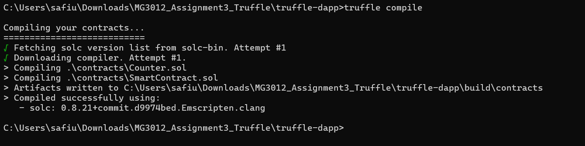
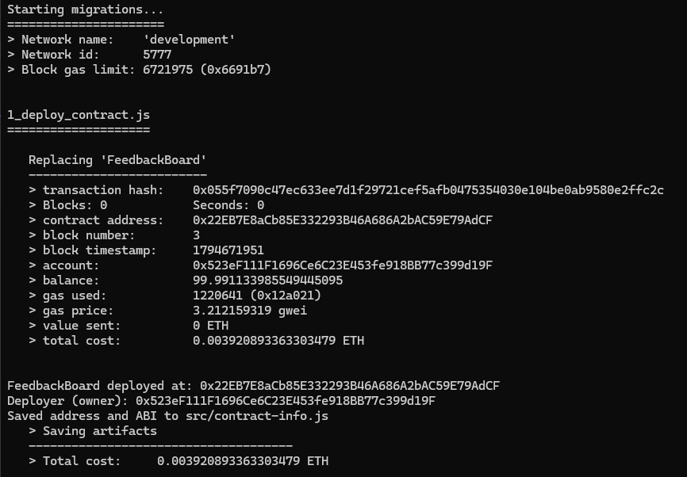
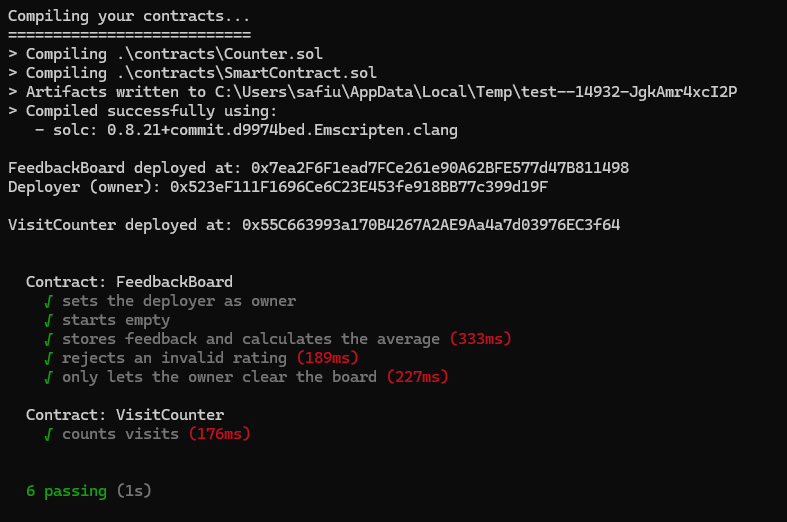
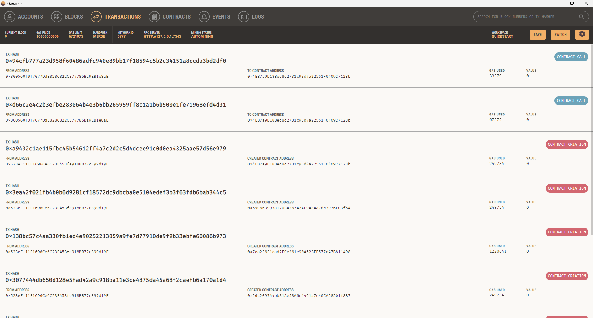
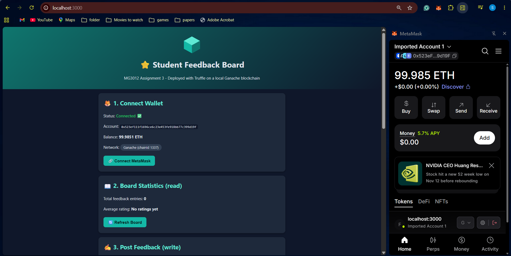
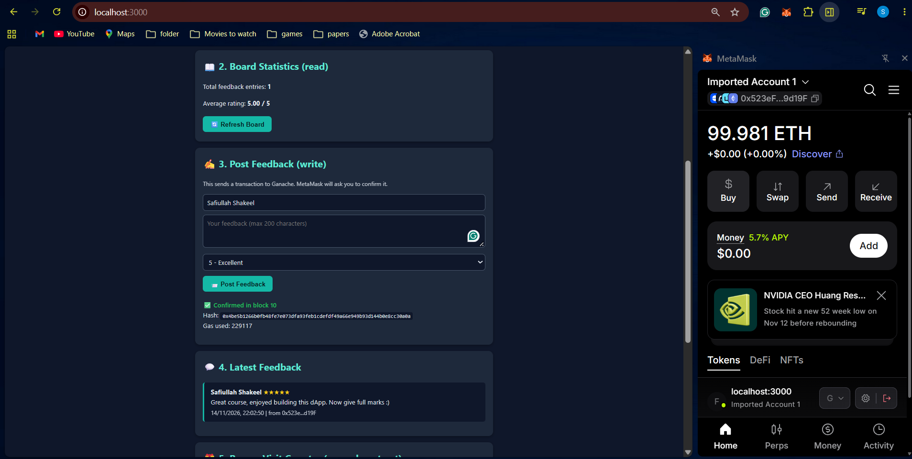

# ⭐ Student Feedback Board - Truffle + Ganache dApp

**MG3012 - Blockchain Technology for Business | Assignment 3 (Fall 2026)**

| | |
|---|---|
| **Student** | Safiullah Shakeel |
| **Roll No.** | 24i-5517 |
| **Instructor** | Dr. Usama Arshad |
| **GitHub repo** | https://github.com/msafidm/MG3012-Assignment3-Truffle |

## 📌 Project Description
This project extends Assignment 2. The same **FeedbackBoard** smart contract (post a 1-5 star feedback, read the count and average) is now compiled and deployed with the **Truffle Suite** to a local **Ganache** blockchain, and a frontend (HTML/CSS/JS + ethers.js + MetaMask) interacts with it.

**Bonus:** a second contract, **VisitCounter**, is deployed by its own migration and has its own section on the page (multiple contracts).

## 🧱 Tech Stack
Solidity ^0.8.20 | Truffle 5.11.x | Ganache | Node.js | ethers.js v5.7.2 | MetaMask | HTML, CSS, JavaScript

## 📂 Project Structure
```
├── contracts/
│   ├── SmartContract.sol        (FeedbackBoard - from Assignment 2)
│   └── Counter.sol              (VisitCounter - bonus second contract)
├── migrations/
│   ├── 1_deploy_contract.js     (deploys FeedbackBoard, saves address + ABI for the frontend)
│   └── 2_deploy_counter.js      (deploys VisitCounter)
├── src/
│   ├── index.html
│   ├── script.js
│   ├── style.css
│   └── contract-info.js         (auto-generated by `truffle migrate`)
├── test/feedbackboard.test.js   (6 automated tests)
├── truffle-config.js
├── package.json
├── README.md
└── screenshots/
```

## 📜 Contract Functions
**FeedbackBoard:** `postFeedback(name, message, rating)` (write), `clearFeedback()` (write, owner only), `getFeedbackCount()`, `getFeedback(index)`, `getAverageRating()` (read).
**VisitCounter:** `visit()` (write), `getVisits()`, `getMyVisits(address)` (read).

## ⚙️ Setup Instructions

### 1. Install the tools
1. Install **Node.js LTS (v18 or v20)** from https://nodejs.org
2. Install Truffle: `npm install -g truffle`
3. Check: `truffle version`
4. Install **Ganache** (desktop app): https://archive.trufflesuite.com/ganache/
   (CLI alternative: `npx ganache --port 7545 --chain.chainId 1337 --wallet.deterministic`)
5. Install the **MetaMask** browser extension.

### 2. Start Ganache
Open Ganache and click **Quickstart (Ethereum)**. It runs at `http://127.0.0.1:7545` with 10 accounts of 100 ETH each.

### 3. Get the project and install dependencies
```bash
cd path/to/this/project
npm install
```

### 4. Compile
```bash
truffle compile
```

### 5. Deploy (migrate) to Ganache
```bash
truffle migrate --reset
```
This deploys both contracts and writes their addresses and ABIs into `src/contract-info.js`, so the frontend needs no manual editing.

### 6. Run the automated tests
```bash
truffle test
```
After testing, the page keeps working because tests do not overwrite `src/contract-info.js`.

### 7. Set up MetaMask for Ganache
1. The page tries to add the network for you. To add it manually: MetaMask > Networks > Add network > Add manually.
   - Network name: `Ganache Local`
   - RPC URL: `http://127.0.0.1:7545`
   - Chain ID: `1337`
   - Currency symbol: `ETH`
2. Import a Ganache account: in Ganache click the **key icon** next to the first account, copy the **private key**, then in MetaMask choose **Import account** and paste it. (Local test keys only, never use a real wallet.)

### 7b. If you restart Ganache
A new Ganache session is a new blockchain, so run `truffle migrate --reset` again. In MetaMask go to Settings > Advanced > **Clear activity tab data** to remove old transaction history (fixes nonce errors).

### 8. Start the frontend
```bash
npm start
```
Open **http://localhost:3000**.

## ▶️ How to Test the dApp
1. Click **Connect MetaMask** (status turns green and shows account, balance, network).
2. **Refresh Board** reads the count and average (free).
3. Enter name, message, rating, click **Post Feedback**, confirm in MetaMask. The transaction hash, block number and gas used appear and the list updates.
4. In section 5, click **I visited!** to test the second contract.
5. Run `truffle test` to see the 6 automated tests pass.

## 🖼️ Screenshots
| Compile | Migrate | Tests |
|---|---|---|
|  |  |  |

| Ganache | dApp UI | Transaction |
|---|---|---|
|  |  |  |

## 🛠️ Commands Used
```bash
npm install -g truffle
truffle init
truffle compile
truffle migrate --reset
truffle test
npm start
```

## 🔐 Notes
- Everything runs on a local blockchain with fake ETH.
- User text is HTML-escaped before it is displayed.
